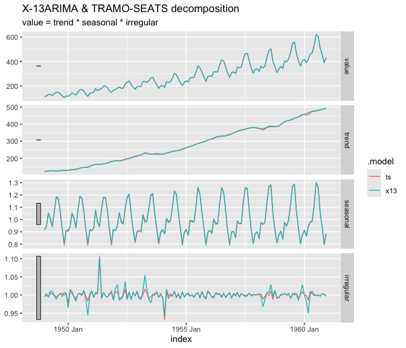

<!-- README.md is generated from README.Rmd. Please edit that file -->

# fable.rjd3 

<!-- badges: start -->

[](https://aqlt.r-universe.dev/fable.rjd3)
[](https://github.com/AQLT/fable.rjd3/actions/workflows/R-CMD-CHECK.yaml)
<!-- badges: end -->

`fable.rjd3` brings the seasonal adjustment algorithms of [JDemetra+
v3](https://github.com/jdemetra/jdplus-main) to the
[`fable`](https://fable.tidyverts.org/) framework. It lets you
seasonally adjust `tsibble` series with the standard `model()` /
`components()` workflow, on one or many series at once, and gives access
to everything JDemetra+ computes.

- **Four models**: `X13()` (X-13ARIMA), `TRAMOSEATS()` (TRAMO-SEATS),
  and the pre-adjustment models `REGARIMA()` and `TRAMO()`.
- **Full control of the specification**, either with the specification
  objects of the `rjd3*` packages or with specials in the model formula,
  including regressors taken from the columns of the `tsibble`.
- **Standard verbs**: `components()`, `forecast()`, `glance()`,
  `tidy()`, `report()`, `fitted()`, `residuals()`, `augment()`,
  `outliers()`, `refit()`, `stream()`, and `backcast()`.
- **Any JDemetra+ indicator** with `jd3_indicator()`, from the Java
  result kept in the model.
- **JDemetra+ workspaces**: `import_jws()` and `export_jws()`.

## Installation

`fable.rjd3` is built on the JDemetra+ v3 R packages (`rjd3toolkit`,
`rjd3x13`, `rjd3tramoseats` and `rjd3workspace`), which requires Java 21
or higher.

To install the developpment version:

- From [r-universe](https://aqlt.r-universe.dev/fable.rjd3):

``` r
install.packages("fable.rjd3", repos = c("https://aqlt.r-universe.dev", "https://cloud.r-project.org"))
```

- From GitHub:

``` r
# install.packages("pak")
pak::pak("AQLT/fable.rjd3")
```

## Example

The series must be a regular, univariate `tsibble` with a `yearmonth` or
`yearquarter` index. Monthly, bimonthly, quarterly, four-monthly and
semi-annual series are supported: the frequency is deduced from the
interval between observations (for example, a `yearmonth` index with a
step of 6 months is a semi-annual series).

``` r
library(fable.rjd3)

air <- as_tsibble(AirPassengers)

mb <- model(
    air,
    x13 = X13(value),
    ts  = TRAMOSEATS(value)
)
mb
#> # A mable: 1 x 2
#>                                x13                                 ts
#>                            <model>                            <model>
#> 1 <X-13ARIMA, ARIMA(0,1,1)(0,1,1)> <TRAMO-SEATS, ARIMA(0,1,0)(0,1,1)>
```

`components()` returns the decomposition as a `dable` (trend, seasonal,
irregular and seasonally adjusted series):

``` r
components(mb)
#> # A dable: 288 x 7 [1M]
#> # Key:     .model [2]
#> # :        value = trend * seasonal * irregular
#>    .model    index value trend seasonal irregular season_adjust
#>    <chr>     <mth> <dbl> <dbl>    <dbl>     <dbl>         <dbl>
#>  1 x13    1949 Jan   112  122.    0.920     0.996          122.
#>  2 x13    1949 Feb   118  124.    0.948     1.00           125.
#>  3 x13    1949 Mar   132  126.    1.05      0.994          125.
#>  4 x13    1949 Apr   129  128.    1.00      1.01           129.
#>  5 x13    1949 May   121  128.    0.939     1.01           129.
#>  6 x13    1949 Jun   135  127.    1.07      0.998          127.
#>  7 x13    1949 Jul   148  126.    1.19      0.988          125.
#>  8 x13    1949 Aug   148  126.    1.17      0.999          126.
#>  9 x13    1949 Sep   136  127.    1.07      1.00           128.
#> 10 x13    1949 Oct   119  128.    0.925     1.00           129.
#> # ℹ 278 more rows
```

``` r
library(ggtime)
ggplot2::autoplot(components(mb))
```



### Specification

The specification is set with the `spec` argument, or with specials in
the formula:

``` r
mb_log <- model(
    air,
    x13 = X13(
        value ~ transform(fun = "Log") +
            outlier(outliers.type = c("AO", "LS")),
        spec = "rsa3"
    )
)
```

### Diagnostics

``` r
glance(mb)
#> # A tibble: 2 × 22
#>   .model  aicc  nobs nparams  nout lb_stat lb_pvalue normality_stat
#>   <chr>  <dbl> <dbl>   <dbl> <dbl>   <dbl>     <dbl>          <dbl>
#> 1 x13     947.   144       6     1    23.9     0.354          0.763
#> 2 ts      936.   144       7     2    30.8     0.128          0.834
#> # ℹ 14 more variables: normality_pvalue <dbl>, ftest_sa_stat <dbl>,
#> #   ftest_sa_pvalue <dbl>, qs_test_sa_stat <dbl>, qs_test_sa_pvalue <dbl>,
#> #   combined_test_sa <chr>, combined_test_sa_lastyears <chr>,
#> #   td_on_sa_stat <dbl>, td_on_sa_pvalue <dbl>, Q <dbl>, Q_M2 <dbl>,
#> #   seas_var <dbl>, irr_var <dbl>, seas_irr_corr <dbl>
tidy(mb_log)
#> # A tibble: 2 × 6
#>   .model term      estimate std.error statistic  p.value
#>   <chr>  <chr>        <dbl>     <dbl>     <dbl>    <dbl>
#> 1 x13    theta(1)    -0.402    0.0896     -4.48 1.62e- 5
#> 2 x13    btheta(1)   -0.557    0.0731     -7.62 5.05e-12
report(mb["x13"])
#> Series: value 
#> Model: X-13ARIMA, ARIMA(0,1,1)(0,1,1) 
#> Mode: Multiplicative; N obs.: 144 
#> 
#> 
#> Coefficients
#>                Estimate Std. Error t value Pr(>|t|)    
#> theta(1)     -0.1155344  0.1085487  -1.064   0.2892    
#> btheta(1)    -0.4974142  0.0722919  -6.881 2.55e-10 ***
#> td2          -0.0029497  0.0005334  -5.530 1.79e-07 ***
#> easter [1]    0.0177674  0.0072985   2.434   0.0163 *  
#> AO (1951-05)  0.1001562  0.0208399   4.806 4.33e-06 ***
#> ---
#> Signif. codes:  0 '***' 0.001 '**' 0.01 '*' 0.05 '.' 0.1 ' ' 1
#> 
#> Tests on residuals: Independence (Ljung-Box: Good, 0.354); Normality (Doornik-Hansen: Good, 0.683)
#> Filters: S3X3, H-9; M-Statistics: q (Good, 0.198); q-m2 (Good, 0.219)
#> Tests on SA: QS (Good, 1.000); F-test (Good, 0.959)
#> Combined test on SA: None (last years: None)
#> Residual trading days on SA (F-test): Good (0.223)
```

### Forecasts

The forecasts of the raw series come from the pre-adjustment model, as
distributions:

``` r
forecast(mb, h = 12)
#> # A fable: 24 x 4 [1M]
#> # Key:     .model [2]
#>    .model    index
#>    <chr>     <mth>
#>  1 x13    1961 Jan
#>  2 x13    1961 Feb
#>  3 x13    1961 Mar
#>  4 x13    1961 Apr
#>  5 x13    1961 May
#>  6 x13    1961 Jun
#>  7 x13    1961 Jul
#>  8 x13    1961 Aug
#>  9 x13    1961 Sep
#> 10 x13    1961 Oct
#> # ℹ 14 more rows
#> # ℹ 2 more variables: value <dist>, .mean <dbl>
```

### Updating a model

``` r
air_old <- air[air$index < yearmonth("1960 Jan"), ]
air_new <- air[air$index >= yearmonth("1960 Jan"), ]

mb_old <- model(air_old, x13 = X13(value))
mb_new <- stream(mb_old, air_new)   # refresh policy "Fixed" by default
```

### JDemetra+ workspaces

``` r
mb <- import_jws("path/to/workspace.xml")   # keys: `sap` and `series`
export_jws(mb, "path/to/new_workspace.xml")
```
