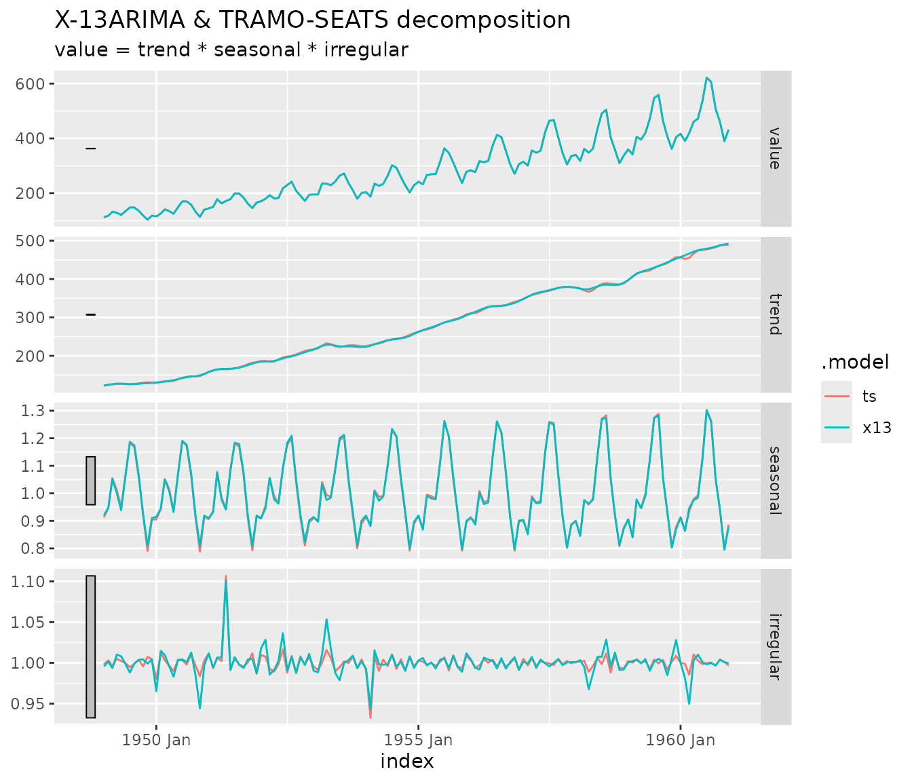

# Seasonal adjustment of tsibbles with fable.rjd3

## Introduction

`fable.rjd3` lets you seasonally adjust `tsibble` series with the
JDemetra+ v3 algorithms, using the
[`fabletools`](https://fabletools.tidyverts.org/) modelling framework.
Four models are available:

| Model | Algorithm | Decomposition |
|:---|:---|:---|
| [`X13()`](https://aqlt.github.io/fable.rjd3/reference/X13.md) | X-13ARIMA ([`rjd3x13::jx13()`](https://rjdverse.github.io/rjd3x13/reference/x13.html)) | yes |
| [`TRAMOSEATS()`](https://aqlt.github.io/fable.rjd3/reference/TRAMOSEATS.md) | TRAMO-SEATS ([`rjd3tramoseats::jtramoseats()`](https://rjdverse.github.io/rjd3tramoseats/reference/tramoseats.html)) | yes |
| [`REGARIMA()`](https://aqlt.github.io/fable.rjd3/reference/REGARIMA.md) | Reg-ARIMA pre-adjustment only ([`rjd3x13::jregarima()`](https://rjdverse.github.io/rjd3x13/reference/regarima.html)) | no |
| [`TRAMO()`](https://aqlt.github.io/fable.rjd3/reference/TRAMO.md) | TRAMO pre-adjustment only ([`rjd3tramoseats::jtramo()`](https://rjdverse.github.io/rjd3tramoseats/reference/tramo.html)) | no |

The fitted models keep the underlying **Java object**. The usual
decomposition is available through
[`components()`](https://generics.r-lib.org/reference/components.html),
and *any* other JDemetra+ indicator (outliers, regression coefficients,
diagnostics…) can be extracted with
[`jd3_indicator()`](https://aqlt.github.io/fable.rjd3/reference/jd3_indicator.md).

The package re-exports the main verbs of `fabletools`
([`model()`](https://fabletools.tidyverts.org/reference/model.html),
[`components()`](https://generics.r-lib.org/reference/components.html),
[`forecast()`](https://generics.r-lib.org/reference/forecast.html),
[`glance()`](https://generics.r-lib.org/reference/glance.html),
[`tidy()`](https://generics.r-lib.org/reference/tidy.html),
[`report()`](https://fabletools.tidyverts.org/reference/report.html)…)
and a few functions of `tsibble`, so that
[`library(fable.rjd3)`](https://aqlt.github.io/fable.rjd3/) is enough.

``` r

library(fable.rjd3)
```

## Quick start

The series must be a univariate `tsibble` with a `yearmonth` or
`yearquarter` index and no gaps. The frequency is deduced from the
interval between the observations, so monthly, bimonthly, quarterly,
four-monthly and semi-annual series are all supported (for example, a
`yearmonth` index with a step of 2 months is a bimonthly series, with a
step of 6 months a semi-annual one). Here we use the classic
`AirPassengers` data.

``` r

air <- as_tsibble(AirPassengers)
air
#> # A tsibble: 144 x 2 [1M]
#>       index value
#>       <mth> <dbl>
#>  1 1949 Jan   112
#>  2 1949 Feb   118
#>  3 1949 Mar   132
#>  4 1949 Apr   129
#>  5 1949 May   121
#>  6 1949 Jun   135
#>  7 1949 Jul   148
#>  8 1949 Aug   148
#>  9 1949 Sep   136
#> 10 1949 Oct   119
#> # ℹ 134 more rows
```

Models are fitted with
[`model()`](https://fabletools.tidyverts.org/reference/model.html),
exactly as with other `fable` models. Several models can be fitted at
once, which makes it easy to compare the two methods.

``` r

mb <- model(
    air,
    x13 = X13(value),
    ts  = TRAMOSEATS(value)
)
mb
#> # A mable: 1 x 2
#>                                x13                                 ts
#>                            <model>                            <model>
#> 1 <X-13ARIMA, ARIMA(0,1,1)(0,1,1)> <TRAMO-SEATS, ARIMA(0,1,0)(0,1,1)>
```

The model summary shows the method and the selected ARIMA model.

## Decomposition

For [`X13()`](https://aqlt.github.io/fable.rjd3/reference/X13.md) and
[`TRAMOSEATS()`](https://aqlt.github.io/fable.rjd3/reference/TRAMOSEATS.md),
[`components()`](https://generics.r-lib.org/reference/components.html)
returns a `dable` with the original series and the columns `trend`,
`seasonal`, `irregular` and `season_adjust`. The relation between the
components follows the decomposition mode of the model (additive,
multiplicative, log-additive or pseudo-additive).

``` r

components(mb)
#> # A dable: 288 x 7 [1M]
#> # Key:     .model [2]
#> # :        value = trend * seasonal * irregular
#>    .model    index value trend seasonal irregular season_adjust
#>    <chr>     <mth> <dbl> <dbl>    <dbl>     <dbl>         <dbl>
#>  1 x13    1949 Jan   112  122.    0.920     0.996          122.
#>  2 x13    1949 Feb   118  124.    0.948     1.00           125.
#>  3 x13    1949 Mar   132  126.    1.05      0.994          125.
#>  4 x13    1949 Apr   129  128.    1.00      1.01           129.
#>  5 x13    1949 May   121  128.    0.939     1.01           129.
#>  6 x13    1949 Jun   135  127.    1.07      0.998          127.
#>  7 x13    1949 Jul   148  126.    1.19      0.988          125.
#>  8 x13    1949 Aug   148  126.    1.17      0.999          126.
#>  9 x13    1949 Sep   136  127.    1.07      1.00           128.
#> 10 x13    1949 Oct   119  128.    0.925     1.00           129.
#> # ℹ 278 more rows
```

With the `ggtime` package, the decomposition can be plotted with
[`autoplot()`](https://ggplot2.tidyverse.org/reference/autoplot.html).

``` r

library(ggtime)
ggplot2::autoplot(components(mb))
```



## Setting the specification

The specification can be defined in two ways, which can be combined.

### Ex ante, with the `spec` argument

`spec` accepts a name (such as `"rsa3"` for
[`X13()`](https://aqlt.github.io/fable.rjd3/reference/X13.md) or
`"rsafull"` for
[`TRAMOSEATS()`](https://aqlt.github.io/fable.rjd3/reference/TRAMOSEATS.md)),
or a specification object created with
[`rjd3x13::x13_spec()`](https://rjdverse.github.io/rjd3x13/reference/x13_spec.html)
/
[`rjd3tramoseats::tramoseats_spec()`](https://rjdverse.github.io/rjd3tramoseats/reference/tramoseats_spec.html)
and modified with the `set_*()` functions of `rjd3toolkit`. This gives
access to everything JDemetra+ offers.

``` r

my_spec <- rjd3x13::x13_spec("rsa3")
my_spec <- rjd3toolkit::set_transform(my_spec, fun = "Log")
my_spec <- rjd3toolkit::add_outlier(my_spec, type = "AO", date = "1955-01-01")

mb_spec <- model(air, x13 = X13(value, spec = my_spec))
glance(mb_spec)
#> # A tibble: 1 × 19
#>   .model  aicc  nobs nparams  nout lb_stat lb_pvalue normality_stat
#>   <chr>  <dbl> <dbl>   <dbl> <dbl>   <dbl>     <dbl>          <dbl>
#> 1 x13     989.   144       4     1    24.3     0.333           3.81
#> # ℹ 11 more variables: normality_pvalue <dbl>, ftest_sa_stat <dbl>,
#> #   ftest_sa_pvalue <dbl>, qs_test_sa_stat <dbl>, qs_test_sa_pvalue <dbl>,
#> #   combined_test_sa <chr>, combined_test_sa_lastyears <chr>,
#> #   td_on_sa_stat <dbl>, td_on_sa_pvalue <dbl>, Q <dbl>, Q_M2 <dbl>
```

### In the formula, with specials

Specials are used on the right-hand side of the formula. Each one
records a call to a function of `rjd3toolkit` (or of the algorithm
package) that is applied to the base specification:

| Special | Calls |
|:---|:---|
| `spec(x)` | base specification, same as the `spec` argument |
| `basic(...)` | [`rjd3toolkit::set_basic()`](https://rjdverse.github.io/rjd3toolkit/reference/set_basic.html) |
| `transform(...)` | [`rjd3toolkit::set_transform()`](https://rjdverse.github.io/rjd3toolkit/reference/set_transform.html) |
| `estimate(...)` | [`rjd3toolkit::set_estimate()`](https://rjdverse.github.io/rjd3toolkit/reference/set_estimate.html) |
| `automodel(...)` | [`rjd3toolkit::set_automodel()`](https://rjdverse.github.io/rjd3toolkit/reference/set_automodel.html) |
| `outlier(...)` | [`rjd3toolkit::set_outlier()`](https://rjdverse.github.io/rjd3toolkit/reference/set_outlier.html) |
| `add_outlier(...)` | [`rjd3toolkit::add_outlier()`](https://rjdverse.github.io/rjd3toolkit/reference/add_outlier.html) |
| `easter(...)` | [`rjd3toolkit::set_easter()`](https://rjdverse.github.io/rjd3toolkit/reference/set_easter.html) |
| `tradingdays(...)` | [`rjd3toolkit::set_tradingdays()`](https://rjdverse.github.io/rjd3toolkit/reference/set_tradingdays.html) |
| `arima(...)` | [`rjd3toolkit::set_arima()`](https://rjdverse.github.io/rjd3toolkit/reference/set_arima.html) |
| `ramp(...)` | [`rjd3toolkit::add_ramp()`](https://rjdverse.github.io/rjd3toolkit/reference/add_outlier.html) |
| `usrdefvar(...)` | [`rjd3toolkit::add_usrdefvar()`](https://rjdverse.github.io/rjd3toolkit/reference/add_usrdefvar.html) |
| `benchmarking(...)` | [`rjd3toolkit::set_benchmarking()`](https://rjdverse.github.io/rjd3toolkit/reference/set_benchmarking.html) ([`X13()`](https://aqlt.github.io/fable.rjd3/reference/X13.md) and [`TRAMOSEATS()`](https://aqlt.github.io/fable.rjd3/reference/TRAMOSEATS.md)) |
| `x11(...)` | [`rjd3x13::set_x11()`](https://rjdverse.github.io/rjd3x13/reference/x11_spec.html) ([`X13()`](https://aqlt.github.io/fable.rjd3/reference/X13.md) only) |
| `seats(...)` | [`rjd3tramoseats::set_seats()`](https://rjdverse.github.io/rjd3tramoseats/reference/set_seats.html) ([`TRAMOSEATS()`](https://aqlt.github.io/fable.rjd3/reference/TRAMOSEATS.md) only) |
| `xreg(...)` | user regressors taken from tsibble columns |

``` r

mb_sp <- model(
    air,
    x13 = X13(
        value ~ transform(fun = "Log") +
            outlier(outliers.type = c("AO", "LS")) +
            x11(seasonal.filter = "S3X5")
    )
)
glance(mb_sp)
#> # A tibble: 1 × 19
#>   .model  aicc  nobs nparams  nout lb_stat lb_pvalue normality_stat
#>   <chr>  <dbl> <dbl>   <dbl> <dbl>   <dbl>     <dbl>          <dbl>
#> 1 x13     947.   144       6     1    23.9     0.354          0.763
#> # ℹ 11 more variables: normality_pvalue <dbl>, ftest_sa_stat <dbl>,
#> #   ftest_sa_pvalue <dbl>, qs_test_sa_stat <dbl>, qs_test_sa_pvalue <dbl>,
#> #   combined_test_sa <chr>, combined_test_sa_lastyears <chr>,
#> #   td_on_sa_stat <dbl>, td_on_sa_pvalue <dbl>, Q <dbl>, Q_M2 <dbl>
```

The base `spec` is applied first, then the specials in a fixed order,
then `xreg()`: later settings override earlier ones. A special that does
not apply to the method (for example
[`x11()`](https://rdrr.io/r/grDevices/x11.html) in
[`TRAMOSEATS()`](https://aqlt.github.io/fable.rjd3/reference/TRAMOSEATS.md))
is ignored with a warning.

The base specification is also stored in the model as the *reference
specification* (argument `ref_spec`, by default equal to `spec`). It is
the reference used by the refresh policies of
[`refit()`](https://generics.r-lib.org/reference/refit.html) and
[`stream()`](https://fabletools.tidyverts.org/reference/stream.html),
see below.

### Regressors from the tsibble

Since a specification created ex ante cannot refer to columns of your
data, regressors are declared with the `xreg()` special. The variables
are added to the modelling context, and to the specification when
`regeffect` is given.

``` r

air$shock <- as.numeric(air$index == yearmonth("1955 Jan"))

mb_xreg <- model(air, x13 = X13(value ~ xreg(shock, regeffect = "Series")))
#> Warning: 1 error encountered for x13
#> [1] unused argument (effect = x$regeffect)
tidy(mb_xreg)
#> # A tibble: 0 × 3
#> # ℹ 3 variables: .model <chr>, term <chr>, estimate <dbl>
```

For custom calendars, build a context with
[`rjd3toolkit::modelling_context()`](https://rjdverse.github.io/rjd3toolkit/reference/modelling_context.html)
and pass it through the `context` argument.

## Extracting results

### Diagnostics and regression terms

- [`glance()`](https://generics.r-lib.org/reference/glance.html) returns
  a one-row summary per model: information criteria, number of
  observations and outliers, tests on the residuals and, for seasonal
  adjustment models, tests on the seasonally adjusted series and the
  quality statistics of the method. Tests give two columns (`_stat` and
  `_pvalue`) and the combined seasonality tests give a text. The set of
  indicators depends on the method; `glance(x, ids = )` takes a vector
  of indicator ids to choose others.
- [`tidy()`](https://generics.r-lib.org/reference/tidy.html) returns one
  row per coefficient (ARIMA parameters, regression variables, outliers,
  calendar effects) with its standard error, statistic and p-value.
  Coefficients fixed in the specification are included.
- [`report()`](https://fabletools.tidyverts.org/reference/report.html)
  prints a summary of one model: the coefficients and the tests, in the
  spirit of [`summary()`](https://rdrr.io/r/base/summary.html) for a
  regression.

``` r

glance(mb)
#> # A tibble: 2 × 22
#>   .model  aicc  nobs nparams  nout lb_stat lb_pvalue normality_stat
#>   <chr>  <dbl> <dbl>   <dbl> <dbl>   <dbl>     <dbl>          <dbl>
#> 1 x13     947.   144       6     1    23.9     0.354          0.763
#> 2 ts      936.   144       7     2    30.8     0.128          0.834
#> # ℹ 14 more variables: normality_pvalue <dbl>, ftest_sa_stat <dbl>,
#> #   ftest_sa_pvalue <dbl>, qs_test_sa_stat <dbl>, qs_test_sa_pvalue <dbl>,
#> #   combined_test_sa <chr>, combined_test_sa_lastyears <chr>,
#> #   td_on_sa_stat <dbl>, td_on_sa_pvalue <dbl>, Q <dbl>, Q_M2 <dbl>,
#> #   seas_var <dbl>, irr_var <dbl>, seas_irr_corr <dbl>
tidy(mb_sp)
#> # A tibble: 5 × 6
#>   .model term         estimate std.error statistic  p.value
#>   <chr>  <chr>           <dbl>     <dbl>     <dbl>    <dbl>
#> 1 x13    theta(1)     -0.116    0.109        -1.06 2.89e- 1
#> 2 x13    btheta(1)    -0.497    0.0723       -6.88 2.55e-10
#> 3 x13    td2          -0.00295  0.000533     -5.53 1.79e- 7
#> 4 x13    easter [1]    0.0178   0.00730       2.43 1.63e- 2
#> 5 x13    AO (1951-05)  0.100    0.0208        4.81 4.33e- 6
report(mb["x13"])
#> Series: value 
#> Model: X-13ARIMA, ARIMA(0,1,1)(0,1,1) 
#> Mode: Multiplicative; N obs.: 144 
#> 
#> 
#> Coefficients
#>                Estimate Std. Error t value Pr(>|t|)    
#> theta(1)     -0.1155344  0.1085487  -1.064   0.2892    
#> btheta(1)    -0.4974142  0.0722919  -6.881 2.55e-10 ***
#> td2          -0.0029497  0.0005334  -5.530 1.79e-07 ***
#> easter [1]    0.0177674  0.0072985   2.434   0.0163 *  
#> AO (1951-05)  0.1001562  0.0208399   4.806 4.33e-06 ***
#> ---
#> Signif. codes:  0 '***' 0.001 '**' 0.01 '*' 0.05 '.' 0.1 ' ' 1
#> 
#> Tests on residuals: Independence (Ljung-Box: Good, 0.354); Normality (Doornik-Hansen: Good, 0.683)
#> Filters: S3X3, H-9; M-Statistics: q (Good, 0.198); q-m2 (Good, 0.219)
#> Tests on SA: QS (Good, 1.000); F-test (Good, 0.959)
#> Combined test on SA: None (last years: None)
#> Residual trading days on SA (F-test): Good (0.223)
```

### Outliers

[`outliers()`](https://fabletools.tidyverts.org/reference/outliers.html)
returns the rows of the data identified as outliers (additive outliers,
level shifts, transitory changes, seasonal outliers) by the
pre-adjustment model. The `type` argument keeps some types only, and the
type and the statistics of each outlier are available in
[`tidy()`](https://generics.r-lib.org/reference/tidy.html).

``` r

outliers(mb)
#> # A tsibble: 3 x 3 [1M]
#> # Key:       .model [2]
#>   .model    index value
#>   <chr>     <mth> <dbl>
#> 1 x13    1951 May   172
#> 2 ts     1951 May   172
#> 3 ts     1954 Feb   188
outliers(mb, type = "AO")
#> # A tsibble: 3 x 3 [1M]
#> # Key:       .model [2]
#>   .model    index value
#>   <chr>     <mth> <dbl>
#> 1 x13    1951 May   172
#> 2 ts     1951 May   172
#> 3 ts     1954 Feb   188
```

### Any JDemetra+ indicator

[`jd3_dictionary()`](https://aqlt.github.io/fable.rjd3/reference/jd3_dictionary.md)
lists the indicators available for a model, and
[`jd3_indicator()`](https://aqlt.github.io/fable.rjd3/reference/jd3_indicator.md)
extracts one of them via
[`rjd3toolkit::result()`](https://rjdverse.github.io/rjd3toolkit/reference/dictionary.html).

``` r

head(jd3_dictionary(mb), 15)
#>  [1] "out_i"      "out_i_f(?)" "out_i_b(?)" "out_t"      "out_t_f(?)"
#>  [6] "out_t_b(?)" "out_s"      "out_s_f(?)" "out_s_b(?)" "reg_i"     
#> [11] "reg_i_f(?)" "reg_i_b(?)" "reg_t"      "reg_t_f(?)" "reg_t_b(?)"

# the raw object, for a single model
jd3_indicator(mb$x13[[1]], "sa")
#>           Jan      Feb      Mar      Apr      May      Jun      Jul      Aug
#> 1949 121.7202 124.5235 125.3989 128.9076 128.8437 126.7308 124.6712 126.0850
#> 1950 125.6865 133.5459 134.2574 133.9260 134.1034 139.5782 142.8219 144.5915
#> 1951 159.3326 160.9571 165.6360 166.9271 182.7617 164.6639 168.0976 168.7858
#> 1952 187.9674 190.2420 182.7310 185.1004 190.0056 200.1497 194.4352 200.1589
#> 1953 214.4421 218.5414 228.2417 240.8908 232.6058 223.6963 219.9353 224.3191
#> 1954 221.9589 213.4096 233.3723 233.2509 236.7465 239.9818 244.8226 242.7448
#> 1955 263.1890 268.4385 269.4705 274.0846 275.9289 283.4864 288.3001 287.9976
#> 1956 311.1830 312.5324 316.4456 325.7445 328.9640 330.2841 327.3915 331.8471
#> 1957 348.6708 353.5923 361.8524 361.0335 367.4152 368.1771 369.5130 374.1977
#> 1958 377.6052 376.3330 371.2029 361.4526 371.8343 383.5362 387.0679 396.5770
#> 1959 397.4726 407.0105 415.3590 418.4369 424.0706 421.5136 430.2867 436.1496
#> 1960 457.3264 452.8993 442.8725 472.5261 479.7372 477.7933 477.9935 481.1243
#>           Sep      Oct      Nov      Dec
#> 1949 127.6503 128.6635 128.4876 129.6968
#> 1950 147.4894 144.6289 140.7914 152.3225
#> 1951 171.1440 176.4124 180.4229 180.5127
#> 1952 199.2426 207.0293 208.8580 215.1385
#> 1953 225.4261 226.5113 221.8871 223.1003
#> 1954 245.5116 245.0260 253.6693 255.4452
#> 1955 294.8441 294.1301 297.0567 308.8018
#> 1956 329.1515 334.5141 340.1138 339.5918
#> 1957 378.4526 377.6560 379.6653 379.2973
#> 1958 383.1635 389.1312 382.3159 386.9628
#> 1959 439.2162 436.7974 450.9071 465.6466
#> 1960 482.6658 489.4866 490.6654 491.8786

# the same indicator for all the models of the mable
jd3_indicator(mb, "sa")
#> # A tibble: 288 × 4
#>    .model id       index value
#>    <chr>  <chr>    <mth> <dbl>
#>  1 x13    sa    1949 Jan  122.
#>  2 x13    sa    1949 Feb  125.
#>  3 x13    sa    1949 Mar  125.
#>  4 x13    sa    1949 Apr  129.
#>  5 x13    sa    1949 May  129.
#>  6 x13    sa    1949 Jun  127.
#>  7 x13    sa    1949 Jul  125.
#>  8 x13    sa    1949 Aug  126.
#>  9 x13    sa    1949 Sep  128.
#> 10 x13    sa    1949 Oct  129.
#> # ℹ 278 more rows
```

For a mable, the result depends on the type of the indicator: a number
gives a column `value`, a series is returned in long format (`index` and
`value`), and a test gives the columns `statistic`, `p.value` and
`distribution`. With several ids, a named list is returned.

``` r

jd3_indicator(mb, "residuals.lb")
#> # A tibble: 2 × 5
#>   .model id           statistic p.value distribution                        
#>   <chr>  <chr>            <dbl>   <dbl> <chr>                               
#> 1 x13    residuals.lb      23.9   0.354 "Chi2 with 22.0 degrees of freedom "
#> 2 ts     residuals.lb      30.8   0.128 "Chi2 with 23.0 degrees of freedom "
jd3_indicator(mb, c("likelihood.aicc", "likelihood.nobs"))
#> $likelihood.aicc
#> # A tibble: 2 × 3
#>   .model id              value
#>   <chr>  <chr>           <dbl>
#> 1 x13    likelihood.aicc  947.
#> 2 ts     likelihood.aicc  936.
#> 
#> $likelihood.nobs
#> # A tibble: 2 × 3
#>   .model id              value
#>   <chr>  <chr>           <dbl>
#> 1 x13    likelihood.nobs   144
#> 2 ts     likelihood.nobs   144
```

## Pre-adjustment models and forecasts

[`REGARIMA()`](https://aqlt.github.io/fable.rjd3/reference/REGARIMA.md)
and [`TRAMO()`](https://aqlt.github.io/fable.rjd3/reference/TRAMO.md)
fit the pre-adjustment model only, with the same specifications and
specials as
[`X13()`](https://aqlt.github.io/fable.rjd3/reference/X13.md) and
[`TRAMOSEATS()`](https://aqlt.github.io/fable.rjd3/reference/TRAMOSEATS.md).
They have no decomposition, so no
[`components()`](https://generics.r-lib.org/reference/components.html),
but all the other methods work.

``` r

mb_pre <- model(air, regarima = REGARIMA(value), tramo = TRAMO(value))
glance(mb_pre)
#> # A tibble: 2 × 11
#>   .model    aicc  nobs nparams  nout lb_stat lb_pvalue normality_stat
#>   <chr>    <dbl> <dbl>   <dbl> <dbl>   <dbl>     <dbl>          <dbl>
#> 1 regarima  947.   144       6     1    23.9     0.354          0.763
#> 2 tramo     936.   144       7     2    30.8     0.128          0.834
#> # ℹ 3 more variables: normality_pvalue <dbl>, lb2_stat <dbl>, lb2_pvalue <dbl>
```

### Forecasts and backcasts

[`forecast()`](https://generics.r-lib.org/reference/forecast.html)
forecasts the raw series from the pre-adjustment model, for the four
models. The result is a distribution: log-normal if the series is
log-transformed, normal otherwise. The default point forecast `.mean` is
the mean of the distribution; use `point_forecast` to choose another
summary, for example the median, which is the forecast given by
JDemetra+.

``` r

forecast(mb_pre, h = 12)
#> # A fable: 24 x 4 [1M]
#> # Key:     .model [2]
#>    .model      index
#>    <chr>       <mth>
#>  1 regarima 1961 Jan
#>  2 regarima 1961 Feb
#>  3 regarima 1961 Mar
#>  4 regarima 1961 Apr
#>  5 regarima 1961 May
#>  6 regarima 1961 Jun
#>  7 regarima 1961 Jul
#>  8 regarima 1961 Aug
#>  9 regarima 1961 Sep
#> 10 regarima 1961 Oct
#> # ℹ 14 more rows
#> # ℹ 2 more variables: value <dist>, .mean <dbl>
forecast(mb_pre, h = 12, point_forecast = list(.median = median))
#> # A fable: 24 x 4 [1M]
#> # Key:     .model [2]
#>    .model      index
#>    <chr>       <mth>
#>  1 regarima 1961 Jan
#>  2 regarima 1961 Feb
#>  3 regarima 1961 Mar
#>  4 regarima 1961 Apr
#>  5 regarima 1961 May
#>  6 regarima 1961 Jun
#>  7 regarima 1961 Jul
#>  8 regarima 1961 Aug
#>  9 regarima 1961 Sep
#> 10 regarima 1961 Oct
#> # ℹ 14 more rows
#> # ℹ 2 more variables: value <dist>, .median <dbl>
```

[`backcast()`](https://aqlt.github.io/fable.rjd3/reference/backcast.md)
does the same for the periods preceding the series.

``` r

backcast(mb, h = 12)
#> # A tibble: 24 × 3
#>    .model    index
#>    <chr>     <mth>
#>  1 x13    1948 Jan
#>  2 x13    1948 Feb
#>  3 x13    1948 Mar
#>  4 x13    1948 Apr
#>  5 x13    1948 May
#>  6 x13    1948 Jun
#>  7 x13    1948 Jul
#>  8 x13    1948 Aug
#>  9 x13    1948 Sep
#> 10 x13    1948 Oct
#> # ℹ 14 more rows
#> # ℹ 1 more variable: dist <dist>
```

### Fitted values, residuals and missing values

[`fitted()`](https://rdrr.io/r/stats/fitted.values.html) and
[`residuals()`](https://rdrr.io/r/stats/residuals.html) give the
one-step-ahead fitted values and the residuals of the pre-adjustment
model, with `NA` where they are not defined. They make
[`augment()`](https://generics.r-lib.org/reference/augment.html) and
[`accuracy()`](https://generics.r-lib.org/reference/accuracy.html) work.

``` r

residuals(mb)
#> # A tsibble: 288 x 3 [1M]
#> # Key:       .model [2]
#>    .model    index .resid
#>    <chr>     <mth>  <dbl>
#>  1 x13    1949 Jan     NA
#>  2 x13    1949 Feb     NA
#>  3 x13    1949 Mar     NA
#>  4 x13    1949 Apr     NA
#>  5 x13    1949 May     NA
#>  6 x13    1949 Jun     NA
#>  7 x13    1949 Jul     NA
#>  8 x13    1949 Aug     NA
#>  9 x13    1949 Sep     NA
#> 10 x13    1949 Oct     NA
#> # ℹ 278 more rows
augment(mb)
#> # A tsibble: 288 x 6 [1M]
#> # Key:       .model [2]
#>    .model    index value .fitted .resid .innov
#>    <chr>     <mth> <dbl>   <dbl>  <dbl>  <dbl>
#>  1 x13    1949 Jan   112      NA     NA     NA
#>  2 x13    1949 Feb   118      NA     NA     NA
#>  3 x13    1949 Mar   132      NA     NA     NA
#>  4 x13    1949 Apr   129      NA     NA     NA
#>  5 x13    1949 May   121      NA     NA     NA
#>  6 x13    1949 Jun   135      NA     NA     NA
#>  7 x13    1949 Jul   148      NA     NA     NA
#>  8 x13    1949 Aug   148      NA     NA     NA
#>  9 x13    1949 Sep   136      NA     NA     NA
#> 10 x13    1949 Oct   119      NA     NA     NA
#> # ℹ 278 more rows
```

[`interpolate()`](https://generics.r-lib.org/reference/interpolate.html)
replaces the missing values of the series by the estimates of the model.

``` r

air_na <- air
air_na$value[c(20, 21)] <- NA
mb_na <- model(air_na, x13 = X13(value))
interpolate(mb_na, air_na)
#> # A tsibble: 144 x 2 [1M]
#>       index value
#>       <mth> <dbl>
#>  1 1949 Jan   112
#>  2 1949 Feb   118
#>  3 1949 Mar   132
#>  4 1949 Apr   129
#>  5 1949 May   121
#>  6 1949 Jun   135
#>  7 1949 Jul   148
#>  8 1949 Aug   148
#>  9 1949 Sep   136
#> 10 1949 Oct   119
#> # ℹ 134 more rows
```

## Updating models

When new observations arrive, a model can be updated with the refresh
policies of JDemetra+ (`"Fixed"` by default: the estimated parameters
are kept; the other policies are `"FreeParameters"`, `"Complete"`,
`"Outliers_StochasticComponent"`, `"Outliers"`, `"FixedParameters"`,
`"FixedAutoRegressiveParameters"` and `"Current"`). The refresh is based
on the estimated specification and on the reference specification stored
in the model.

- [`stream()`](https://fabletools.tidyverts.org/reference/stream.html)
  appends the new observations to the data of the model;
- [`refit()`](https://generics.r-lib.org/reference/refit.html) applies
  the model to a new complete dataset.

``` r

start_new <- yearmonth("1960 Jan")
air_old <- air[air$index < start_new, c("index", "value")]
air_new <- air[air$index >= start_new, c("index", "value")]
mb_old  <- model(air_old, x13 = X13(value))

mb_ext <- stream(mb_old, air_new)
components(mb_ext)
#> # A dable: 144 x 7 [1M]
#> # Key:     .model [1]
#> # :        value = trend * seasonal * irregular
#>    .model    index value trend seasonal irregular season_adjust
#>    <chr>     <mth> <dbl> <dbl>    <dbl>     <dbl>         <dbl>
#>  1 x13    1949 Jan   112  122.    0.919     0.995          122.
#>  2 x13    1949 Feb   118  125.    0.949     0.998          124.
#>  3 x13    1949 Mar   132  127.    1.05      0.997          126.
#>  4 x13    1949 Apr   129  128.    0.996     1.01           130.
#>  5 x13    1949 May   121  128.    0.943     1.00           128.
#>  6 x13    1949 Jun   135  127.    1.07      0.999          127.
#>  7 x13    1949 Jul   148  126.    1.19      0.989          125.
#>  8 x13    1949 Aug   148  126.    1.17      0.999          126.
#>  9 x13    1949 Sep   136  127.    1.07      1.00           128.
#> 10 x13    1949 Oct   119  128.    0.925     1.01           129.
#> # ℹ 134 more rows

mb_refit <- refit(mb_old, air[c("index", "value")], policy = "FreeParameters")
```

## Several series

Because models are defined through `fabletools`, keyed tsibbles work as
usual: one model is fitted per series.

``` r

a <- as.data.frame(air[c("index", "value")]); a$series <- "A"
b <- a; b$value <- sqrt(b$value) * 10; b$series <- "B"
two <- as_tsibble(rbind(a, b), index = index, key = series)

mb2 <- model(two, x13 = X13(value))
mb2
#> # A mable: 2 x 2
#> # Key:     series [2]
#>   series                              x13
#>   <chr>                           <model>
#> 1 A      <X-13ARIMA, ARIMA(0,1,1)(0,1,1)>
#> 2 B      <X-13ARIMA, ARIMA(0,1,0)(0,1,1)>
glance(mb2)
#> # A tibble: 2 × 20
#>   series .model  aicc  nobs nparams  nout lb_stat lb_pvalue normality_stat
#>   <chr>  <chr>  <dbl> <dbl>   <dbl> <dbl>   <dbl>     <dbl>          <dbl>
#> 1 A      x13     947.   144       6     1    23.9     0.354          0.763
#> 2 B      x13     635.   144       5     1    26.7     0.269          0.531
#> # ℹ 11 more variables: normality_pvalue <dbl>, ftest_sa_stat <dbl>,
#> #   ftest_sa_pvalue <dbl>, qs_test_sa_stat <dbl>, qs_test_sa_pvalue <dbl>,
#> #   combined_test_sa <chr>, combined_test_sa_lastyears <chr>,
#> #   td_on_sa_stat <dbl>, td_on_sa_pvalue <dbl>, Q <dbl>, Q_M2 <dbl>
```

## JDemetra+ workspaces

[`import_jws()`](https://aqlt.github.io/fable.rjd3/reference/import_jws.md)
reads a JDemetra+ workspace and fits its SA-items with the
specifications it contains. The result is a mable with two keys, `sap`
(the SA-processing) and `series` (the SA-item), and a model column `sa`.
The estimation specification of the item is the specification of the
model, its reference specification is kept for the refresh policies, and
the modelling context of the workspace (calendars and user-defined
variables) is shared by all the models.

``` r

file <- system.file("workspaces", "workspace_test.xml", package = "rjd3workspace")
mb_jws <- import_jws(file)
mb_jws
#> # A mable: 9 x 3
#> # Key:     sap, series [9]
#>   sap            series                                 sa
#>   <chr>          <chr>                             <model>
#> 1 SAProcessing-1 RF0812   <X-13ARIMA, ARIMA(2,1,1)(0,1,1)>
#> 2 SAProcessing-1 RF0893   <X-13ARIMA, ARIMA(0,1,1)(0,1,1)>
#> 3 SAProcessing-1 RF0899   <X-13ARIMA, ARIMA(0,1,1)(0,1,1)>
#> 4 SAProcessing-1 RF1011   <X-13ARIMA, ARIMA(2,1,0)(0,1,1)>
#> 5 SAProcessing-1 RF1012   <X-13ARIMA, ARIMA(1,1,1)(0,1,1)>
#> 6 SAProcessing-2 RF0893 <TRAMO-SEATS, ARIMA(1,1,1)(0,1,1)>
#> 7 SAProcessing-2 RF0899 <TRAMO-SEATS, ARIMA(0,1,1)(0,1,1)>
#> 8 SAProcessing-2 RF1011   <X-13ARIMA, ARIMA(0,1,2)(0,1,1)>
#> 9 SAProcessing-2 RF1012 <TRAMO-SEATS, ARIMA(1,1,1)(0,1,1)>
```

[`export_jws()`](https://aqlt.github.io/fable.rjd3/reference/export_jws.md)
does the opposite: it writes a new workspace, readable by the JDemetra+
graphical interface, from a mable of models. A workspace has a single
context, so regressors of different series that have the same name but
different values are renamed `<name>_<sap>_<series>`, in the context and
in the specifications. Results, comments and links to data providers are
not exported, and the series are stored as static data.

``` r

export_jws(mb_jws, tempfile(fileext = ".xml"))
```

## Saving and reloading models

The Java object cannot be serialized: after
[`saveRDS()`](https://rdrr.io/r/base/readRDS.html) /
[`readRDS()`](https://rdrr.io/r/base/readRDS.html) (or when a model is
created on a `future` worker) the Java pointer is no longer valid.
`fable.rjd3` handles this transparently: the data, the specifications
and the context are stored as regular R objects, and the first time an
extraction
([`components()`](https://generics.r-lib.org/reference/components.html),
[`glance()`](https://generics.r-lib.org/reference/glance.html),
[`jd3_indicator()`](https://aqlt.github.io/fable.rjd3/reference/jd3_indicator.md),
[`forecast()`](https://generics.r-lib.org/reference/forecast.html)…) is
called on a reloaded model, the model is re-estimated. The following
calls use the new Java object.

``` r

f <- tempfile(fileext = ".rds")
saveRDS(mb, f)
mb_reloaded <- readRDS(f)

components(mb_reloaded)                 # the models are re-estimated here
#> # A dable: 288 x 7 [1M]
#> # Key:     .model [2]
#> # :        value = trend * seasonal * irregular
#>    .model    index value trend seasonal irregular season_adjust
#>    <chr>     <mth> <dbl> <dbl>    <dbl>     <dbl>         <dbl>
#>  1 x13    1949 Jan   112  122.    0.920     0.996          122.
#>  2 x13    1949 Feb   118  124.    0.948     1.00           125.
#>  3 x13    1949 Mar   132  126.    1.05      0.994          125.
#>  4 x13    1949 Apr   129  128.    1.00      1.01           129.
#>  5 x13    1949 May   121  128.    0.939     1.01           129.
#>  6 x13    1949 Jun   135  127.    1.07      0.998          127.
#>  7 x13    1949 Jul   148  126.    1.19      0.988          125.
#>  8 x13    1949 Aug   148  126.    1.17      0.999          126.
#>  9 x13    1949 Sep   136  127.    1.07      1.00           128.
#> 10 x13    1949 Oct   119  128.    0.925     1.00           129.
#> # ℹ 278 more rows
jd3_indicator(mb_reloaded, "sa")        # no new estimation
#> # A tibble: 288 × 4
#>    .model id       index value
#>    <chr>  <chr>    <mth> <dbl>
#>  1 x13    sa    1949 Jan  122.
#>  2 x13    sa    1949 Feb  125.
#>  3 x13    sa    1949 Mar  125.
#>  4 x13    sa    1949 Apr  129.
#>  5 x13    sa    1949 May  129.
#>  6 x13    sa    1949 Jun  127.
#>  7 x13    sa    1949 Jul  125.
#>  8 x13    sa    1949 Aug  126.
#>  9 x13    sa    1949 Sep  128.
#> 10 x13    sa    1949 Oct  129.
#> # ℹ 278 more rows
```

The estimation uses the versions of the `rjd3*` packages installed when
the model is reloaded, which can differ from the versions used to fit
it.

## Limitations

- Only `yearmonth` and `yearquarter` indices are supported, and the
  series must be univariate and regular. The interval between
  observations must divide a year, and a series with an interval of
  several months must start at the beginning of a period (for example in
  January or July for a semi-annual series).
- The forecasts are those of the pre-adjustment model of the raw series;
  the components (trend, seasonal, irregular) are not forecasted.
- The available indicator ids depend on the installed version of the
  `rjd3*` packages; use
  [`jd3_dictionary()`](https://aqlt.github.io/fable.rjd3/reference/jd3_dictionary.md)
  to list them.
- [`import_jws()`](https://aqlt.github.io/fable.rjd3/reference/import_jws.md)
  only imports the SA-items estimated with an X-13ARIMA or a TRAMO-SEATS
  specification.
